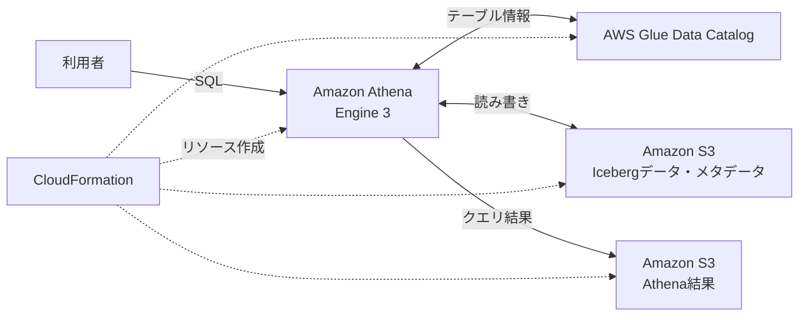

# AWS Iceberg Lakehouse Lab

AWS CloudFormationで、通常のAmazon S3、AWS Glue Data Catalog、Amazon Athena（Engine 3）を使った **Apache Iceberg v2** の小規模なデータレイクハウス検証環境を構築するサンプルです。

実際にINSERT / SELECT / UPDATE / DELETE / Time Travel / OPTIMIZE / VACUUMの動作を確認したテンプレートを公開しています。検証用のSQLはCloudFormationがAthenaの「保存したクエリ」として登録します。

## 構成



構築するリソース：

| リソース | 用途 |
|---|---|
| S3データバケット | IcebergのParquet・メタデータを保存 |
| S3結果バケット | Athenaのクエリ結果（7日間のライフサイクル設定） |
| Glue Data Catalogデータベース | 既定名: `lakehouse_lab` |
| Athenaワークグループ | `lakehouse-lab-wg`、Engine 3 |
| Athena保存済みクエリ9本 | CREATE / INSERT / SELECT / UPDATE / DELETE / snapshots / files / OPTIMIZE / VACUUM |

**注意:** CloudFormationはIcebergのテーブル自体を作成しません。デプロイ後に、保存済みクエリ01のSQLをAthenaで実行します。Glue ETLジョブ、Lake Formationの権限設定、IAMユーザー・ロールの作成は含みません。

## デプロイ

1. AWSコンソールでCloudFormationを開き、対象リージョンを選択します。
2. 「スタックの作成」で [lakehouse-lab.yaml](./lakehouse-lab.yaml) をアップロードします。
3. スタック名を `lakehouse-lab` にし、必要に応じてパラメータを変更します。
4. `CREATE_COMPLETE` を確認し、スタックの「出力」タブでデータバケット名とワークグループ名を確認します。

AWS CLIの場合：

```bash
aws cloudformation deploy \
  --template-file lakehouse-lab.yaml \
  --stack-name lakehouse-lab \
  --region ap-southeast-2
```

リージョンは各自の環境に合わせて変更してください。

| パラメータ | 既定値 | 内容 |
|---|---|---|
| `DatabaseName` | `lakehouse_lab` | Glueのデータベース名 |
| `QueryScanLimitBytes` | `1073741824` | Athenaの1クエリ当たりスキャン量上限（1GiB） |

スキャン量上限は料金の上限ではありません。S3などの利用料金が別途発生する可能性があります。

## Athenaでの検証

Athenaでワークグループ `lakehouse-lab-wg`、データベース `lakehouse_lab` を選び、以下を実行します。

| 保存済みクエリの末尾 | 用途 |
|---|---|
| `01-create-iceberg-table` | テーブル作成 |
| `02-insert-sample-rows` | Alice・Bob・Carolの3件を登録（原則1回） |
| `03-select-rows` | データ参照 |
| `06-show-snapshots` | INSERT直後のスナップショットIDを記録 |
| `04-update-row` | Aliceの金額・ステータスを更新 |
| `05-delete-row` | Carolを削除 |
| `06-show-snapshots`, `07-show-files` | 更新後の履歴とデータファイルを確認 |
| `08-optimize-iceberg` | データファイルを最適化 |
| `09-vacuum-iceberg` | 期限切れスナップショットなどを整理 |

### Time Travel

INSERT直後のスナップショットIDを指定して、変更前のデータを参照します。

```sql
SELECT *
FROM lakehouse_lab.orders
FOR VERSION AS OF 1234567890123456789
ORDER BY order_id;
```

上のIDはサンプルです。実際に取得したスナップショットIDに置き換えてください。保持期間が過ぎてスナップショットが削除されると、その時点へのTime Travelはできません。

### Icebergが参照するデータファイル

```sql
SELECT content, file_path, record_count, file_size_in_bytes
FROM "lakehouse_lab"."orders$files";
```

実際の検証では、UPDATE・DELETE後にデータファイル2つ（物理レコード合計4件）とPosition Deleteファイル2つが存在し、OPTIMIZE後には現在有効な2レコードを持つ1つのデータファイルに再編成されました。結果は実行環境により異なります。

## セキュリティ・コスト

- データバケット・結果バケットはパブリックアクセスをブロックし、SSE-S3暗号化と非TLSアクセスの拒否を設定します。
- AWSアカウントIDやアクセスキーはテンプレートに固定していません。バケット名にはCloudFormationの疑似パラメータを使います。
- Athenaワークグループに1クエリ1GiBのスキャン量上限を設けていますが、費用の上限ではありません。
- S3ストレージやリクエスト、Athenaクエリ、Glue Data Catalogの利用などには料金が発生することがあります。
- 検証専用です。本番環境ではIAM/Lake Formationの権限管理、監視、保持期間、バックアップ等を別途検討してください。

## 環境の削除

1. 検証結果や履歴の保存が不要であることを確認します。
2. Athenaで `DROP TABLE IF EXISTS lakehouse_lab.orders;` を実行します（データ削除の影響を理解したうえで実施）。
3. CloudFormationの「出力」を参照し、データ用バケットとAthena結果用バケットを**両方空に**します。
4. CloudFormationスタック `lakehouse-lab` を削除し、`DELETE_COMPLETE` を確認します。

S3バケットにオブジェクトが残っていると、テンプレートが `DeletionPolicy: Delete` であってもバケット削除は失敗します。

## 参考資料

- [AthenaでApache Icebergを使用する](https://docs.aws.amazon.com/athena/latest/ug/querying-iceberg.html)
- [OPTIMIZE statement](https://docs.aws.amazon.com/athena/latest/ug/optimize-statement.html)
- [VACUUM statement](https://docs.aws.amazon.com/athena/latest/ug/vacuum-statement.html)
